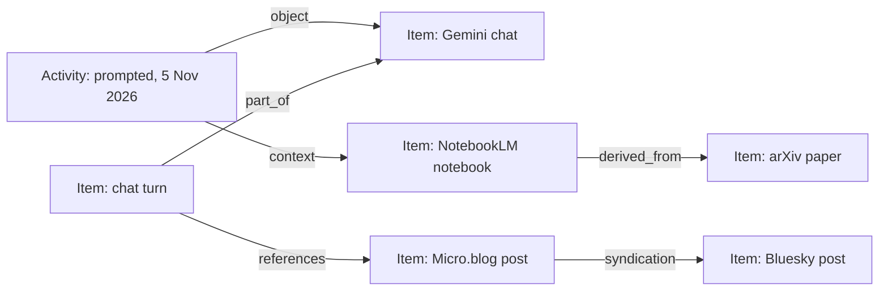

# Content and Activity Ontology Design

*Proposed 2026-11-07 — not yet implemented*

## Overview

LeStash stores things and the events around them in one shape: the item.
This proposal separates them into two vocabularies that meet at the item.

- **Content** says what exists and how pieces relate: a post cites a paper, a notebook is built from a PDF.
- **Activity** says what you did and when: watched a video, prompted Gemini, edited a Doc.
- Both reuse published terms, so LeStash composes an ontology rather than inventing one.
- Two smaller vocabularies already exist in part: **people** (`person_profiles`) and **topics** (`tags`).

## Why now

The 6 November Takeout export and the Drive API hold data that fits neither shape well.

| Data | Volume | Shape |
|---|---|---|
| YouTube activity (`My Activity/YouTube`) | 76,328 watches, Jun 2020 – Nov 2026 | events |
| Gemini activity (`My Activity/Gemini Apps`) | 3,082 prompts in ~670 chats, Oct 2024 – Nov 2026 | events that produce content |
| YouTube comments (`comments.csv`) | 79 comments, 41 of them replies | content replying to content |
| Drive files (Drive API) | 71,102 files, 69,517 with a last edit by you | content, plus events via the Drive Activity API |

LeStash holds 10,463 YouTube watches and 19 full Gemini chats today.

Items also link across sources, but nothing records it.

| Link found in the live database | Count |
|---|---|
| Content holds the web address of an item from another source | 587 |
| Bluesky post is a cross-post of a Micro.blog post | 86 |
| Gemini prompt names the NotebookLM notebook it used | 164 |
| NotebookLM source is a PDF already imported from Drive | 14 |
| NotebookLM source names an arXiv paper | 33 (2 in LeStash) |

`docs/search-and-collections-research.md` named this gap in March: related items across sources are "isolated islands".
Collections and vector "similar items" help, but neither says *how* two items relate.

## Current state

- `items.parent_id` — one parent per item: conversation → turns, notebook → notes, post → comments.
- `collections`, `collection_items` — manual groups (13 collections, 203 entries).
- `tags`, `item_tags` — topics, kinds `ad-hoc` and `category` (23 tags).
- `person_profiles` — people, mostly LinkedIn (56 rows).
- `syndications` — audit of your own cross-posts sent from LeStash (2 rows).
- Events live inside item metadata as timestamp lists, such as `watched_times` and `searched_times`.
- `items.created_at` mixes meanings: when a post was written, a video first watched, a search first run.

## Prior art

No single standard covers links in a personal archive.
Established vocabularies each cover one concern, and they share a split between things and events.

- **W3C PROV-O** separates *Entity* (a thing) from *Activity* (what happened), with *Agent* for who.
- **ActivityStreams 2.0** separates *Object* from *Activity*, with *Actor*.
- **schema.org** has `CreativeWork` properties for content, and `Action` types for events.
- **Dublin Core terms** cover general relations between documents.
- **IndieWeb microformats** (`h-entry`) cover cross-posting and replies.
  The Micro.blog plugin already stores its `syndication` web addresses (156 posts).

## The content ontology

Items stay as they are. Relations between items gain types.

### Containment stays as `parent_id`

`parent_id` keeps its role as `part_of` (`dcterms:isPartOf`, `schema:isPartOf`).
An item has one container, and listings hide children by default.

### Typed links

| Kind | Meaning | Published term | Inverse shown as |
|---|---|---|---|
| `references` | A's content links to or names B | `dcterms:references`, `schema:mentions` | referenced by |
| `syndication` | B is a cross-posted copy of A | microformats `u-syndication` | original |
| `derived_from` | A was built from B, as a notebook from its sources | `prov:wasDerivedFrom`, `dcterms:source` | source of |
| `in_reply_to` | A is a reply or comment on B | ActivityStreams `inReplyTo`, `u-in-reply-to` | replies |
| `alternate_of` | A and B are the same thing in two places | `prov:alternateOf` | (symmetric) |

- `in_reply_to` overlaps `part_of` for comments.
  A comment's `parent_id` stays its video; `in_reply_to` records which comment it answers.
- `alternate_of` is deliberately weaker than `owl:sameAs`.
  A Drive PDF and the same PDF inside a NotebookLM notebook are linked, not merged.

### Proposed table

```sql
CREATE TABLE item_links (
    from_id    INTEGER NOT NULL REFERENCES items(id) ON DELETE CASCADE,
    to_id      INTEGER NOT NULL REFERENCES items(id) ON DELETE CASCADE,
    kind       TEXT NOT NULL,   -- one of the kinds above
    evidence   TEXT,            -- what matched: a URL, an arXiv id, a file name
    origin     TEXT NOT NULL,   -- 'linker:url', 'import:takeout', 'manual'
    created_at TEXT NOT NULL DEFAULT CURRENT_TIMESTAMP,
    PRIMARY KEY (from_id, to_id, kind)
);
CREATE INDEX idx_item_links_to ON item_links(to_id, kind);
```

### How links get made

- **Importers** write links they know for certain, such as a comment's video.
- **A linker pass** runs after each sync, beside `resolve_parent_source_ids`, and matches:
  - web addresses in content against item URLs (`references`);
  - Micro.blog `syndication` addresses against Bluesky and LinkedIn items (`syndication`);
  - NotebookLM source names against arXiv ids and Drive titles (`derived_from`, `alternate_of`).
- Every link carries its evidence, so a wrong match can be traced and removed.
- The primary key makes reruns add nothing new.

## The activity ontology

An activity is something you did, at a time, usually to an item.

### Verbs

| Verb | Example | schema.org | ActivityStreams |
|---|---|---|---|
| `watched` | a YouTube video | `WatchAction` | `View` |
| `searched` | a YouTube query | `SearchAction` | — |
| `viewed` | a community post | `ViewAction` | `View` |
| `liked` | a video | `LikeAction` | `Like` |
| `shared` | a video | `ShareAction` | `Announce` |
| `commented` | on a video | `CommentAction` | `Create` |
| `prompted` | a Gemini chat | `AskAction` | `Create` |
| `created` | a Gemini Canvas, a Drive file | `CreateAction` | `Create` |
| `edited` | a Drive Doc | `UpdateAction` | `Update` |
| `listened` | an Audible book | `ListenAction` | `Listen` |

The actor is always you, so it is not stored.

### Proposed table

```sql
CREATE TABLE activities (
    id          INTEGER PRIMARY KEY,
    verb        TEXT NOT NULL,
    item_id     INTEGER REFERENCES items(id) ON DELETE CASCADE,  -- the object, if known
    occurred_at TEXT NOT NULL,                                    -- UTC
    source      TEXT NOT NULL,     -- 'takeout:youtube', 'drive-activity', ...
    context_id  INTEGER REFERENCES items(id),  -- e.g. the notebook a prompt used
    details     TEXT,              -- JSON: query text, product, client
    UNIQUE (verb, item_id, occurred_at, source)
);
CREATE INDEX idx_activities_time ON activities(occurred_at);
CREATE INDEX idx_activities_item ON activities(item_id);
```

- `item_id` is the object: the video watched, the file edited.
- `context_id` follows ActivityStreams `context`: the Gemini prompt that used a notebook is `prompted`, object the chat, context the notebook.
  So "used notebook" is an activity's context, not a content link kind.
- A search has no object item, so its text goes in `details`.
- Activities that make content point at it: a prompt's reply is a turn item, linked as PROV `wasGeneratedBy`.

### What moves from metadata

- `watched_times`, `searched_times` and `viewed_times` become rows.
- The item keeps a summary (`first_at`, `last_at`, counts) for listings.
- `created_at` can then mean one thing: when the content was made, where known.

### What it enables

- "What was I working on when" becomes one query across YouTube, Gemini, Drive and Audible.
- Drive activity lands as `created` and `edited` rows against file items, without file content.

## How the two meet



- Content links answer "what is related to this".
- Activities answer "when did I touch this, and what else then".

## People and topics

These exist and are out of scope here.

- **People:** `person_profiles` maps to PROV *Agent* and ActivityStreams *Actor*.
  Channels and authors are plain text in `items.author` today.
- **Topics:** `tags` maps to SKOS concepts. An item's subject is `schema:about`.

## Plan

1. Gemini activity importer: chats with prompt and reply turns, matched to the 19 existing chats by id.
2. YouTube activity importer: the 76,328 watches, merged into history items by video id, plus comments.
3. `item_links` table and the linker pass.
4. `activities` table, then moving timestamp lists into it.
5. Drive Activity API source; needs the `drive.activity.readonly` scope and a new sign-in.

Steps 1 and 2 work with today's shape and gain links and activities as those land.

## Open questions

- Should a YouTube watch without a known video item create a stub item, or an activity with no object?
- Should NotebookLM sources become items, or stay as names in notebook metadata?
- How far back does the Drive Activity API reach? Not yet checked.
- Should the linker's text matches be shown as suggestions before they count as links?

## References

- [W3C PROV-O](https://www.w3.org/TR/prov-o/)
- [ActivityStreams 2.0 Vocabulary](https://www.w3.org/TR/activitystreams-vocabulary/)
- [schema.org CreativeWork](https://schema.org/CreativeWork) and [Action](https://schema.org/Action)
- [DCMI Metadata Terms](https://www.dublincore.org/specifications/dublin-core/dcmi-terms/)
- [microformats h-entry](https://microformats.org/wiki/h-entry)
- [SKOS](https://www.w3.org/TR/skos-reference/)
