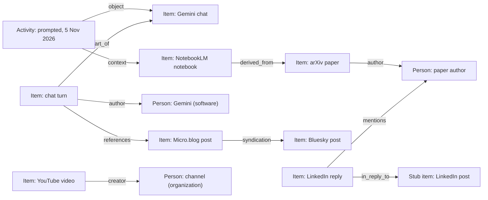

# Content and Activity Ontology Design

*Proposed 2026-11-07 — the Gemini importer has shipped (#214); the rest is planned in #222*

## Overview

LeStash stores things and the events around them in one shape: the item.
This proposal separates them into vocabularies that meet at the item.

- **Content** says what exists and how pieces relate: a post cites a paper, a notebook is built from a PDF.
- **Activity** says what you did and when: watched a video, prompted Gemini, edited a Doc.
- **People** says who made, voiced or received each item: a channel, an author, Gemini.
- All three reuse published terms, so LeStash composes an ontology rather than inventing one.
- **Topics** (`tags`) already exist and stay out of scope.

## Why now

The 6 November Takeout export and the Drive API hold data that fits neither shape well.

| Data | Volume | Shape |
|---|---|---|
| YouTube activity (`My Activity/YouTube`) | 76,328 watches, Jun 2020 – Nov 2026 | events |
| Gemini activity (`My Activity/Gemini Apps`) | 3,082 prompts in ~670 chats, Oct 2024 – Nov 2026 | events that produce content |
| YouTube comments (`comments.csv`) | 79 comments, 41 of them replies | content replying to content |
| Drive files (Drive API) | 71,102 files, 69,517 with a last edit by you | content, plus events via the Drive Activity API |

LeStash holds 10,463 YouTube watches and 19 full Gemini chats today.

Items also link across sources, but nothing records it.

| Link found in the live database | Count |
|---|---|
| Content holds the web address of an item from another source | 587 |
| Bluesky post is a cross-post of a Micro.blog post | 86 |
| Gemini prompt names the NotebookLM notebook it used | 164 |
| NotebookLM source is a PDF already imported from Drive | 14 |
| NotebookLM source names an arXiv paper | 33 (2 in LeStash) |

People are plain text spread across sources.

| Source | Where the name lives | Distinct |
|---|---|---|
| YouTube | `items.author` (the channel) | 4,786 |
| LinkedIn | `items.author` URNs, plus `person_profiles` names | 246 URNs, 56 named |
| arXiv | `metadata.authors` | 188 |
| Audible | authors and narrators | 30 and 35 |

`docs/search-and-collections-research.md` named this gap in March: related items across sources are "isolated islands".
Collections and vector "similar items" help, but neither says *how* two items relate.

## Current state

- `items.parent_id` — one parent per item: conversation → turns, notebook → notes, post → comments.
- `items.author` — display text: a channel name, a LinkedIn URN, a chat role.
- `collections`, `collection_items` — manual groups (13 collections, 203 entries).
- `tags`, `item_tags` — topics, kinds `ad-hoc` and `category` (23 tags).
- `person_profiles` — people, mostly LinkedIn (56 rows).
- `syndications` — audit of your own cross-posts sent from LeStash (2 rows).
- Events live inside item metadata as timestamp lists, such as `watched_times` and `searched_times`.
- `items.created_at` mixes meanings: when a post was written, a video first watched, a search first run.

## Prior art

No single standard covers links in a personal archive.
Established vocabularies each cover one concern, and they share a split between things and events.

- **W3C PROV-O** separates *Entity* (a thing) from *Activity* (what happened), with *Agent* for who.
  *SoftwareAgent* covers programs such as Gemini.
- **ActivityStreams 2.0** separates *Object* from *Activity*, with *Actor*.
  Its actor types include *Person*, *Organization*, *Group* and *Service*.
- **schema.org** has `CreativeWork` properties for content, and `Action` types for events.
  `creator`, `author` and `mentions` take a `Person` or `Organization`.
- **Dublin Core terms** cover general relations between documents.
- **FOAF** `OnlineAccount` models one person's account on one platform.
- **IndieWeb microformats** (`h-entry`) cover cross-posting and replies.
  The Micro.blog plugin already stores its `syndication` web addresses (156 posts).

## The content ontology

Items stay as they are. Relations between items gain types.

### Containment stays as `parent_id`

`parent_id` keeps its role as `part_of` (`dcterms:isPartOf`, `schema:isPartOf`).
An item has one container, and listings hide children by default.

### Stub items for things not held

A link needs both ends to be items, even when LeStash holds only one.

- A thing LeStash knows of but does not hold becomes a stub item.
- A stub holds the web address and identifier, such as `urn:li:ugcPost:7419141931718467584`.
- `items.held` marks it: `0` for a stub, `1` for content LeStash holds.
- Default listings hide stubs, as they hide children.
- A later import of the same identifier fills the stub in, and its links stay.
- Five replies to one post link to one stub, not to five bare addresses.

```sql
ALTER TABLE items ADD COLUMN held INTEGER NOT NULL DEFAULT 1;
```

`items.content` is NOT NULL, so a stub stores an empty string.

### Typed links

| Kind | Meaning | Published term | Inverse shown as |
|---|---|---|---|
| `references` | A's content links to or names B | `dcterms:references`, `schema:mentions` | referenced by |
| `syndication` | B is a cross-posted copy of A | microformats `u-syndication` | original |
| `derived_from` | A was built from B, as a notebook from its sources | `prov:wasDerivedFrom`, `dcterms:source` | source of |
| `in_reply_to` | A is a reply or comment on B | ActivityStreams `inReplyTo`, `u-in-reply-to` | replies |
| `alternate_of` | A and B are the same thing in two places | `prov:alternateOf` | (symmetric) |

- `in_reply_to` overlaps `part_of` for comments.
  A comment's `parent_id` stays its video; `in_reply_to` records which comment it answers.
- `alternate_of` is deliberately weaker than `owl:sameAs`.
  A Drive PDF and the same PDF inside a NotebookLM notebook are linked, not merged.

### NotebookLM sources become items

- Each source in a notebook becomes an item, linked from the notebook as `derived_from`.
- A source LeStash already holds is not copied: the existing item is the link target.
  14 sources are Drive PDFs already imported, and 2 are arXiv papers in LeStash.
- A web page or pasted text whose text LeStash lacks becomes a stub.

### Proposed table

```sql
CREATE TABLE item_links (
    from_id    INTEGER NOT NULL REFERENCES items(id) ON DELETE CASCADE,
    to_id      INTEGER NOT NULL REFERENCES items(id) ON DELETE CASCADE,
    kind       TEXT NOT NULL,   -- one of the kinds above
    evidence   TEXT,            -- what matched: a URL, an arXiv id, a file name
    origin     TEXT NOT NULL,   -- 'linker:url', 'import:takeout', 'manual'
    status     TEXT NOT NULL,   -- suggested, confirmed, rejected
    created_at TEXT NOT NULL DEFAULT CURRENT_TIMESTAMP,
    PRIMARY KEY (from_id, to_id, kind)
);
CREATE INDEX idx_item_links_to ON item_links(to_id, kind);
```

### How links get made

- **Importers** write links they know for certain, such as a comment's video.
- **A linker pass** runs after each sync, beside `resolve_parent_source_ids`, and matches:
  - web addresses in content against item URLs (`references`);
  - Micro.blog `syndication` addresses against Bluesky and LinkedIn items (`syndication`);
  - NotebookLM source names against arXiv ids and Drive titles (`derived_from`, `alternate_of`).
- Every link carries its evidence, so a wrong match can be traced and removed.
- The primary key makes reruns add nothing new.

### Which links count at once

| Match | Count today | Status on creation |
|---|---|---|
| Importer knows it, such as a comment's video | — | `confirmed` |
| Exact web address in content | 587 | `confirmed` |
| Micro.blog `syndication` address | 86 | `confirmed` |
| arXiv id in a NotebookLM source | 2 | `confirmed` |
| File name or title, such as a NotebookLM source and a Drive PDF | 14 | `suggested` |

- An exact identifier rarely points at the wrong item, so it counts at once.
- A name or title match waits for you to confirm it.
- Every counted link shows a remove action; removing sets `status = 'rejected'`.
- A rejected link keeps its row, so the linker never adds it again.
- Listings and related-item views show `confirmed` links only.

### As built (#216, step 3)

- Migration 17 creates `item_links` as proposed.
- The linker (`core/links.py`) runs after each sync that writes items, after an upload, and as `lestash db link`.
- It matches web addresses in content against item addresses, after dropping the scheme, `www.`, a trailing slash and the fragment.
  A YouTube address in any form (watch, `youtu.be`, shorts) matches by video id, preferring the `history:` item.
- A Bluesky or LinkedIn post holding the address of a Micro.blog post that lists that service in its `syndication` is a `syndication` link; any other match is `references`.
- All are `confirmed`. The detail view lists them both ways, and its remove action sets `rejected`.
- On a copy of the live database: 959 links, 878 `references` and 81 `syndication`, in 0.7 s.
- Not yet: NotebookLM source links, which wait for sources to become items.
- A link stays when its address is later edited out of the content.

### As built (#216, step 3b)

- Migration 18 adds `items.held`, default `1`; a stub has `0` and empty `content`.
- `core/stubs.py` makes a stub once per identifier, with `source_id` `stub:<identifier>`, so no import writes over it.
- When the thing itself is imported, its stub is merged into it.
  Links, activities, notes, tags, collections and media move to the imported item, and the stub is deleted.
- Listings, keyword search, embeddings and `/api/stats` skip stubs.
  The detail view shows a stub's address, links and activity, without edit, tag, note or collection actions.
  `PATCH /api/items/{id}` refuses a stub with 409, since a merge would lose the edit.
- The first importer to make stubs is LinkedIn, after `resolve_linkedin_parents`:
  - A post named by a URN made within 2 s of a held post's URN (a share and its activity) is that post, and becomes the parent.
    The resolver now matches exact URNs only: its 5 s time bucket also matched distinct posts, and a merge deletes the stub.
  - Otherwise the post gets a stub. A comment that is replied to or reacted to gets its own stub, which replies to its post.
  - A comment without a parent links to its target as `in_reply_to`, and stays top-level, so listings still show it.
    A comment with a parent has no such link, whichever was imported first.
  - Your own reaction is a `liked` activity on its target, with the reaction type in `details`.
    Its time is LinkedIn's UTC time, never the local `created_at`, so a run in another time zone adds no second like.
  - Only the event that made a reaction counts; a change or a delete adds no like.
  - Someone else's reaction waits for the people tables, since an activity without an actor is yours.
- On a copy of the live database: 1,218 stubs (941 posts, 277 comments), 985 `in_reply_to` links and 887 `liked` activities.
  35 comments and reactions on your posts gain their parent; the 168 parents already set stay.
  The pass takes 0.1 s.

## The people ontology

A person is an agent: whoever made, voiced, published or received an item.
`people` replaces `person_profiles` as the hub, and accounts hang off it.

### Kinds

| Kind | Example | PROV-O | ActivityStreams | schema.org |
|---|---|---|---|---|
| `person` | an arXiv author, a LinkedIn contact, you | `Person` | `Person` | `Person` |
| `organization` | a YouTube channel, a publisher | `Organization` | `Organization` | `Organization` |
| `group` | a LinkedIn group, a mailing list | `Agent` | `Group` | `Organization` |
| `software` | Gemini, Claude, Mistral | `SoftwareAgent` | `Service` | `SoftwareApplication` |

- A person known only by a name is a `people` row with no accounts.
- Exactly one row has `is_self = 1`: you.

### YouTube channels

- Each channel is an `organization` row of its own, with the channel address as its account.
- A video links to its channel with role `creator`, as Google's `VideoObject` markup does.
- A channel run by one person stays separate from that person until you link them.
- All 4,786 channels become rows, so no watch loses its channel.
- Listings show channels with five or more watches by default.

| Channels with | Watches | Distinct videos |
|---|---|---|
| any | 4,786 | 4,786 |
| more than 1 | 1,312 | 1,208 |
| 5 or more | 352 | 330 |
| 10 or more | 137 | 125 |

These counts cover the 10,463 watches held today, and rise with the Takeout import.

### AI chat turns

- A chat turn's author is a `software` agent, derived from the source and the turn's role.
- A Gemini `model` turn is authored by Gemini; a Claude `assistant` turn by Claude.
- A `user` turn is authored by you.
- A specific model version can be its own agent when the source names it.
- The role word stays in metadata, and `items.author` stays as display text.
- Until the people tables land, a Gemini turn's `items.author` stays `user` or `model`.
- The app's chat view reads that word and shows "You" or "Gemini".

### Roles

An item links to its agents through `item_agents`.

| Role | Meaning | Published term |
|---|---|---|
| `author` | wrote the text | `schema:author`, `dcterms:creator` |
| `creator` | made the work, such as a channel's video | `schema:creator` |
| `narrator` | voiced an audiobook | `schema:readBy` |
| `publisher` | issued the work | `schema:publisher` |
| `recipient` | the item was sent to them | `schema:recipient`, AS `to` |

### Mentions

A mention is not a role: the item is about or names someone, without them taking part.

- `item_mentions` records an item naming a person or a topic (`schema:mentions`).
- An item naming another item stays an `item_links` row of kind `references`.

### Same person across sources

- Nothing links automatically: the linker only suggests.
- You confirm or reject each suggestion.
- Every account link and mention records its evidence and origin.
- A rejection is kept, so the same suggestion does not return.
- A name-only sighting in a new source is a suggestion against existing people.

### Proposed tables

```sql
CREATE TABLE people (
    id         INTEGER PRIMARY KEY,
    name       TEXT NOT NULL,
    kind       TEXT NOT NULL,              -- person, organization, group, software
    is_self    INTEGER NOT NULL DEFAULT 0,
    created_at TEXT NOT NULL DEFAULT CURRENT_TIMESTAMP
);
CREATE UNIQUE INDEX idx_people_self ON people(is_self) WHERE is_self = 1;

CREATE TABLE person_identities (       -- foaf:OnlineAccount
    id           INTEGER PRIMARY KEY,
    person_id    INTEGER REFERENCES people(id) ON DELETE SET NULL,  -- null until linked
    platform     TEXT NOT NULL,        -- 'youtube', 'linkedin', 'arxiv', ...
    identifier   TEXT NOT NULL,        -- channel id, member URN, author name
    display_name TEXT,
    url          TEXT,
    status       TEXT NOT NULL DEFAULT 'suggested',  -- suggested, confirmed, rejected
    evidence     TEXT,                 -- why it was linked: same URL, same name
    origin       TEXT NOT NULL,        -- 'import:youtube', 'linker:name', 'manual'
    UNIQUE (platform, identifier)
);

CREATE TABLE item_agents (
    item_id   INTEGER NOT NULL REFERENCES items(id) ON DELETE CASCADE,
    person_id INTEGER NOT NULL REFERENCES people(id) ON DELETE CASCADE,
    role      TEXT NOT NULL,           -- author, creator, narrator, publisher, recipient
    position  INTEGER,                 -- author order, where it matters
    evidence  TEXT,
    origin    TEXT NOT NULL,
    PRIMARY KEY (item_id, person_id, role)
);
CREATE INDEX idx_item_agents_person ON item_agents(person_id, role);

CREATE TABLE item_mentions (            -- schema:mentions
    item_id   INTEGER NOT NULL REFERENCES items(id) ON DELETE CASCADE,
    person_id INTEGER REFERENCES people(id) ON DELETE CASCADE,
    tag_id    INTEGER REFERENCES tags(id) ON DELETE CASCADE,
    status    TEXT NOT NULL DEFAULT 'suggested',  -- suggested, confirmed, rejected
    evidence  TEXT,
    origin    TEXT NOT NULL,
    CHECK ((person_id IS NULL) <> (tag_id IS NULL))
);
CREATE UNIQUE INDEX idx_item_mentions_person ON item_mentions(item_id, person_id) WHERE person_id IS NOT NULL;
CREATE UNIQUE INDEX idx_item_mentions_tag ON item_mentions(item_id, tag_id) WHERE tag_id IS NOT NULL;
```

- An importer that knows an account for certain links it as `confirmed`.
- A rejected identity keeps its row with `status = 'rejected'`, which blocks the suggestion.

### As built (#216, step 4a)

- Migration 19 creates the four tables as proposed, and adds `activities.actor_id` (null is you).
- The agents pass (`core/agents.py`) runs after each sync that writes items, after an upload, and as `lestash db agents`.
  It reads identifiers importers already store, and gives each new account one person:

  | Source | Account | Kind | Role |
  |---|---|---|---|
  | YouTube | channel id | `organization` | `creator` |
  | LinkedIn | member or company URN | `person`, `organization` | `author` |
  | Bluesky | DID | `person` | `author` |
  | arXiv | none: a name, in order | `person` | `author` |
  | Audible | none: author, narrator and publisher names | `person`, `organization` | `author`, `narrator`, `publisher` |
  | Email | address | `person` | `author`, `recipient` |
  | Email | mailing list (`List-Id`) | `group` | `publisher` |
  | Gemini, Mistral, Claude, Claude Code | the turn's role word | `software`, or you | `author` |

- An agent known only by name is a person with no account, one per item, as a name can be several people.
  The name linker will suggest which are the same. Deleting one makes it again on the next pass.
- Deleting a person with an account keeps the account, belonging to no one, so the pass doesn't make them again.
- The pass only adds: an agent whose item later names someone else stays, until a later step re-derives them.
- `activities.actor_id` has no delete action: null means you, so a deleted person's activities must not become yours.
  Deleting a person whom activities name is refused until those activities are moved or deleted.
- An account the source marks as yours belongs to the one `is_self` person: your LinkedIn owner URN, your own Bluesky DID, the address on emails marked yours and sent under your name, and `user` turns.
  Gmail marks no message yours: a Gmail sender is you only when the address is already yours.
  Your accounts are recorded first, so an address of yours first seen on an email you received is still yours.
  When the pass first makes you, you are named from your LinkedIn profile, then your Bluesky posts; else by the first account of yours that gives a name; else "You".
  An account of yours an earlier pass gave someone else, such as your address on an email you received, moves to you when an import made it and it was that person's only account.
- Each account is `confirmed`, with its evidence (`channel id`, `member URN`) and origin (`import:<source>`).
  Nothing joins two other accounts into one person; suggestions arrive with the linker for names.
- A YouTube video with a channel name but no channel id gets no creator: the name alone could be several channels.
- A message a mailing list relays ("'Ann' via UAI Mailing List") comes from the list's address, so the list is its publisher and the poster is unnamed.
- A person named by an account's identifier, such as a URN, takes the first real name a later sighting gives.
- Free-text authors (Kobo, web pages, notes) wait, since splitting a line of names would be a guess.
- LinkedIn gives no names for members: a member not in `person_profiles` is named by their URN, 219 of 257 today.
- The detail view lists an item's people by role, each linked to their channel, profile or address.
- On a copy of the live database: 18,179 organizations, 535 people, 1 group, 3 software agents and you; 90,044 item agents.
  The pass takes 1.5 s, and 1.0 s when nothing is new.
- Not yet: `item_mentions` (filled by a name linker), retiring `person_profiles`, and `actor_id` for others' LinkedIn reactions.

### As built (#216, step 4b)

- The agents pass also fills `item_mentions` from LinkedIn tags: a post, comment or message's text attributes name a member or company URN, and where its name sits.
- Each is `confirmed`, with evidence `tagged` and origin `import:linkedin`, as a URN names one member for certain.
- Offsets count UTF-16 code units, so an emoji before a name counts two.
- A tag writes the member's name, so it also names people known only by URN.
  The longest way a name is written wins ("Matthew Thompson" over "Matthew"); a `person_profiles` name wins over both.
  A profile cut from a mention does not: an older script cut by code points, which garbled names after an emoji ("Max Langley 🤣⚖︎💩 s"). The script now cuts by UTF-16 units too.
- A LinkedIn person still named as the pass named them follows the best name the current sources give, so a longer one found later replaces it; a name you set is kept.
- The detail view lists mentions after the item's agents, as "Mentions".
- On a copy of the live database: 462 mentions of 125 people, 9 companies and you (115).
  People named by URN fall from 219 to 174.
- Not yet:
  - Hashtags, which wait for a decision on how topic tags sit beside your tags.
  - Bluesky mentions, as the importer keeps only link facets.
  - The name linker, which suggests that two people are the same.

## The activity ontology

An activity is something someone did, at a time, usually to an item.

### Verbs

| Verb | Example | schema.org | ActivityStreams |
|---|---|---|---|
| `watched` | a YouTube video | `WatchAction` | `View` |
| `searched` | a YouTube query | `SearchAction` | — |
| `viewed` | a community post | `ViewAction` | `View` |
| `liked` | a video | `LikeAction` | `Like` |
| `shared` | a video | `ShareAction` | `Announce` |
| `commented` | on a video | `CommentAction` | `Create` |
| `prompted` | a Gemini chat | `AskAction` | `Create` |
| `created` | a Gemini Canvas, a Drive file | `CreateAction` | `Create` |
| `edited` | a Drive Doc | `UpdateAction` | `Update` |
| `listened` | an Audible book | `ListenAction` | `Listen` |

### Proposed table

```sql
CREATE TABLE activities (
    id          INTEGER PRIMARY KEY,
    verb        TEXT NOT NULL,
    actor_id    INTEGER REFERENCES people(id),                    -- null means you
    item_id     INTEGER REFERENCES items(id) ON DELETE CASCADE,  -- the object, if known
    occurred_at TEXT NOT NULL,                                    -- UTC
    source      TEXT NOT NULL,     -- 'takeout:youtube', 'drive-activity', ...
    context_id  INTEGER REFERENCES items(id),  -- e.g. the notebook a prompt used
    details     TEXT,              -- JSON: query text, product, client
    UNIQUE (verb, item_id, occurred_at, source)
);
CREATE INDEX idx_activities_time ON activities(occurred_at);
CREATE INDEX idx_activities_item ON activities(item_id);
```

- `actor_id` is null for your own activity, which is nearly all of it.
  It is set for others, such as a contact who reacted to your post.
- `item_id` is the object: the video watched, the file edited.
- A watch of a video LeStash does not hold points at a stub item for that video.
- `context_id` follows ActivityStreams `context`: the Gemini prompt that used a notebook is `prompted`, object the chat, context the notebook.
  So "used notebook" is an activity's context, not a content link kind.
- A search has no object item, so its text goes in `details`.
- Activities that make content point at it: a prompt's reply is a turn item, linked as PROV `wasGeneratedBy`.

### As built (#216, step 1)

- Migration 14 creates the table and fills it from the times lists already in item metadata; 15 indexes `context_id`.
- Two triggers on `items` recorded each new time a later import added; migration 16 removed them (step 1b).
- `occurred_at` is UTC, as `2026-11-08T17:35:03.123Z`, so different exports' precisions match.
- `actor_id` arrives with the `people` table, since SQLite refuses a foreign key to a table that doesn't exist.
- `context_id` is set to null when its item is deleted, instead of blocking the delete.
- A search points at its stored `search:` item, which holds the query; `details` repeats the query.
- The item detail view lists the item's activities.

### What moves from metadata

- `watched_times`, `searched_times` and `viewed_times` become rows.
- The item keeps a summary (`first_at`, `last_at`, counts) for listings.

### As built (#216, step 1b)

- Migration 16 removes `watched_times`, `viewed_times`, `searched_times` and `prompted_times` from item metadata.
  It first records any listed time not yet an activity.
  `item_history` keeps each item's old metadata, tagged `migration 16: times lists moved to activities`.
- The YouTube history and Gemini activity importers attach their times to each item as `ItemCreate.activities`.
- The writers that store Takeout items call `record_activities()` once the item has an id.
- A re-import reads the stored times from `activities`, then updates the count, `first_at`, `last_at` and the content summary.
- Times are no longer capped at 200 per item.
  A count can exceed the stored times for an item whose list was capped before.

### As built (#216, step 2)

- The YouTube history importer also reads `My Activity/YouTube/My Activity.json`; importer version 4.
- Watches, searches and community post views merge into the same items as the history files, by video id, query or post id.
- Likes, dislikes and shares of a video are `liked`, `disliked` and `shared` activities of its `history:` item.
  A video only liked, disliked or shared still gets that item, without a watch count.
- Subscriptions, saved playlists, poll votes and dismissed suggestions are skipped; YouTube Music and ads are skipped as before.
- Comments (`comments.csv`) are not in this export part, so they wait for a later step.
- `created_at` can then mean one thing: when the content was made, where known.

### What it enables

- "What was I working on when" becomes one query across YouTube, Gemini, Drive and Audible.
- Drive activity lands as `created` and `edited` rows against file items, without file content.

## How they meet



- Content links answer "what is related to this".
- Agent links answer "who made this, and what else did they make".
- Activities answer "when did I touch this, and what else then".

## Topics

`tags` maps to SKOS concepts and stays as it is. An item's subject is `schema:about`.

## Plan

The roadmap is tracked in #222, one issue per waypoint.

**Done:** the Gemini activity importer (#214): chats with prompt and reply turns, matched to the 19 existing chats by id.

0. **Fix-ups (#215):** #208, #209 and #210, plus about 20 search queries recorded as a baseline.
1. **Ontology (#216):**
   1. `activities` table, then moving timestamp lists into it.
   2. YouTube activity importer: the 76,328 watches, merged into history items by video id, plus comments.
   3. `items.held`, the `item_links` table and the linker pass.
   4. `people`, `person_identities`, `item_agents` and `item_mentions`, filled from `items.author`, then `person_profiles` retired.
2. **Blob store (#217):** one SHA-256 file store in `~/.local/share/lestash/`, versioned `item_media`,
   and NotebookLM generated artifacts as child items with their files, slide images included.
3. **Text extraction (#218):** Docling, OCR and faster-whisper write a file's text into its item's `content`,
   with `## Slide 7` or `## 12:34` style headings.
4. **Related items (#219):** nearest neighbours in `vec_items` become `item_links` rows with status `suggested`.
5. **Drive Activity (#220):** needs the `drive.activity.readonly` scope and a new sign-in.
   Google's reference does not say how far back activity goes, so the first query records the oldest date found.

**Later (#221):** review whether semantic search needs to cover whole items, by rerunning the waypoint 0 baseline.

The `activities` table comes first in waypoint 1, so the YouTube import writes its watches there from the start.
Each waypoint ends when its result shows in the item detail view, not only in the database.

## Decided

- A YouTube watch without a known video item points at a stub item.
- NotebookLM sources become items, reusing items LeStash already holds.
- Every YouTube channel becomes an entity; listings filter by watch count.
- Nothing links people automatically; every match is a suggestion you confirm.
- Item links from exact identifiers count at once and can be removed; name matches wait for you.
- Gemini turns keep `user` and `model` as their author until the people tables exist.
- Imports never guess which item something belongs to; unmatched data stays separate.
- No chunking for now: keyword search covers full text, and semantic search keeps one vector per item (#221).
- Extracted text goes into item `content`; `item_history` keeps the text a re-extraction replaces.
- NotebookLM slide decks keep the PDF, the PPTX and every per-slide image.

## References

- [W3C PROV-O](https://www.w3.org/TR/prov-o/)
- [ActivityStreams 2.0 Vocabulary](https://www.w3.org/TR/activitystreams-vocabulary/)
- [schema.org CreativeWork](https://schema.org/CreativeWork), [Action](https://schema.org/Action) and [VideoObject](https://schema.org/VideoObject)
- [Google video structured data](https://developers.google.com/search/docs/appearance/structured-data/video)
- [DCMI Metadata Terms](https://www.dublincore.org/specifications/dublin-core/dcmi-terms/)
- [FOAF OnlineAccount](http://xmlns.com/foaf/spec/#term_OnlineAccount)
- [microformats h-entry](https://microformats.org/wiki/h-entry)
- [SKOS](https://www.w3.org/TR/skos-reference/)
- [Drive Activity API](https://developers.google.com/workspace/drive/activity/v2/reference/rest)
